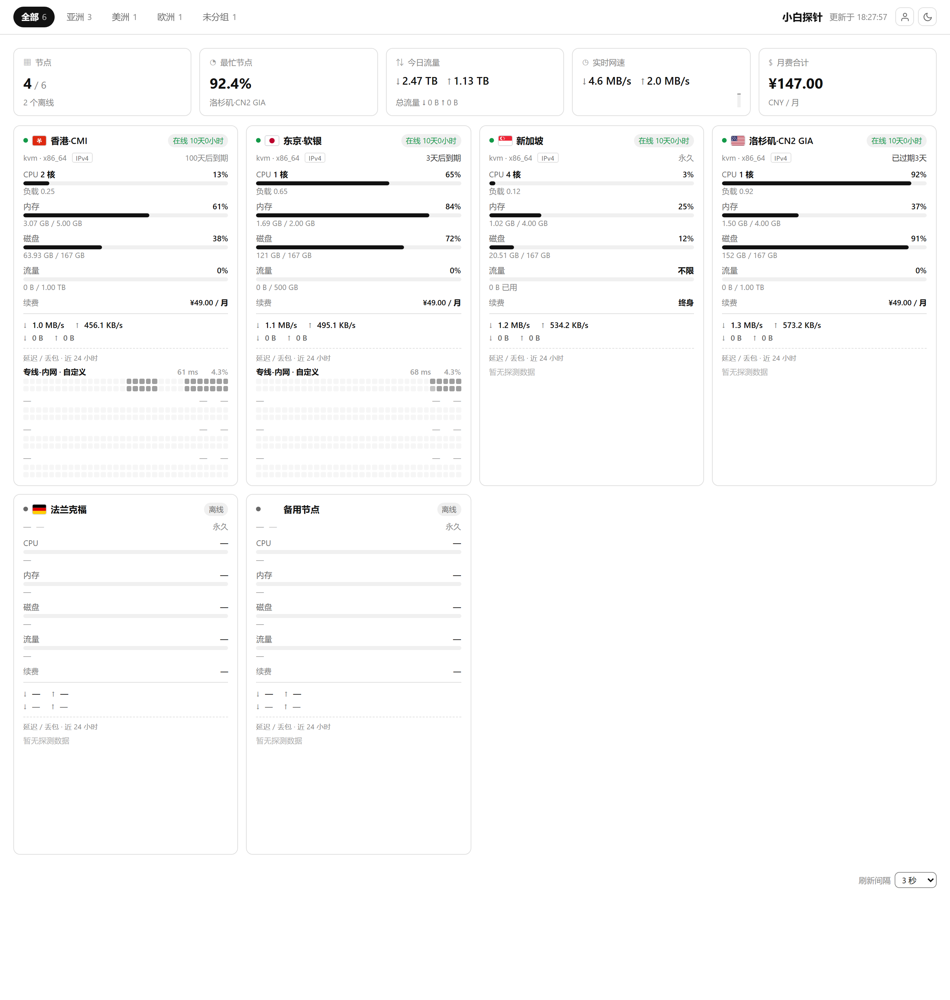
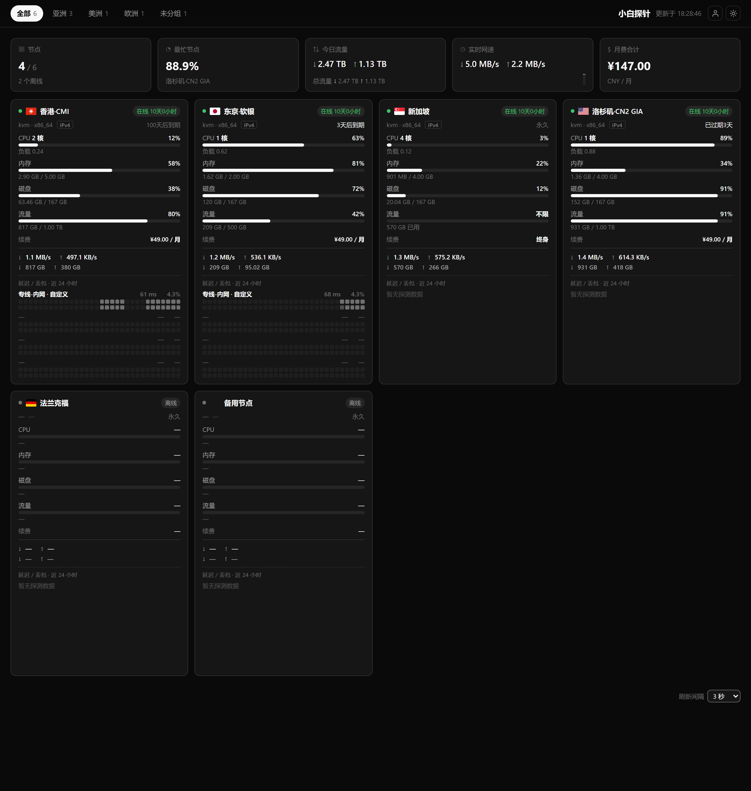
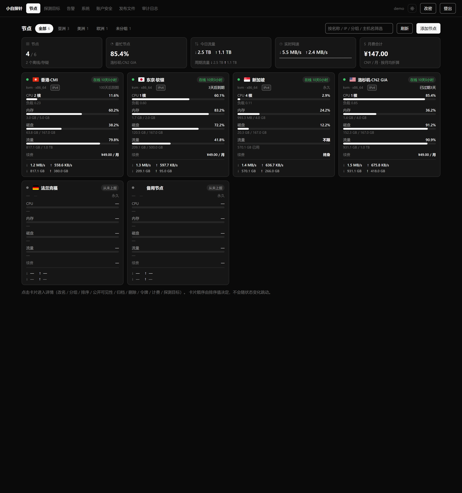

# XB-Probe（自用轻量级服务器探针）

> **关于名字**：项目名是 **XB-Probe**。代码里的默认站点标题、`docs/` 里的历史记录、
> CI 与模块路径仍写作 "Server Probe"（`module github.com/yourorg/probe`）——
> 这些是**内部代号**，改动它们会牵动源码、配置模板与全部文档，属于一次单独的改名动作，
> 本轮有意不动：**这个仓库的代码与上游开发目录 `server-probe/` 逐字节一致**，
> 以便继续双向同步。要改默认站点标题只需在管理端「设置 → 站点」里改，不必改代码。

面向个人多节点 VPS 的极轻量、高安全、可插拔监控与资产管理系统。

一个 **Master** 二进制（内嵌 SQLite、管理后台、公开看板与 IANA 时区库，零外部依赖）+ 若干 **Agent**
（纯外联上报，不监听任何端口）即可管理任意多台节点。Master 自带 HTTPS，也可以只做前置反代后面的应用；
公开看板与管理后台既能两个域名分离、也能同站，**运行时切换、无需重启**。

状态：`go vet` 无告警 · `go test ./...` 25 个包全绿 · 26 个发布产物交叉编译通过（13 平台 × Master/Agent）·
端到端冒烟 311 项通过（0 失败 / 1 跳过）· 备份恢复演练 35 项通过（0 失败 / 1 跳过）。

## 特性

- **零入站攻击面**：Agent 纯外联，不监听端口，防火墙可全阻断入站；Master 从不主动连接 Agent，
  系统**不存在任何远程控制通道**（含远程卸载与远程命令）。
- **展示与管理物理隔离**：公开看板走独立 DTO 白名单（模型里根本没有 IP / 令牌 / 价格字段），
  可分两个域名，也可同站。
- **单文件、零依赖**：全 Go，免 CGO 的内嵌 SQLite（`modernc.org/sqlite`）；前端只用原生
  HTML/CSS/JS（不引 CDN），因此 CSP 可以钉死在 `default-src 'self'`。
- **自带 HTTPS**：内置零依赖 ACME v2 客户端（**域名证书 + RFC 8738 IP 证书**、
  `http-01` / `tls-alpn-01`），也可以使用已有证书、自签证书，或交给前置 Caddy/Nginx。
- **多平台采集**：Linux（`/proc` + `/sys`，含 cgroup v1/v2 与容器识别）、Windows（纯 Win32 API，
  无外部命令）、FreeBSD（`sysctl` + `NET_RT_IFLIST`）。**macOS 明确不支持**。
- **告警与资产**：离线 / 资源阈值 / 「探测连续失败」三类告警（按 `(节点, 类型)` 独立冷却，
  恢复通知不受冷却限制），Telegram 与 SMTP 渠道；计费周期、月费折算、流量配额与续期提醒。

| 公开看板（浅色） | 管理后台（浅色） |
| --- | --- |
|  |  |
|  |  |

## 一键部署（Linux）

在**全新机器**上一条命令完成：检查/安装依赖（git、Go）→ `git clone` 拉取源码 → 编译 →
交互式配置 → 注册 systemd 服务并启动 → 健康检查。

```bash
sudo sh -c "$(curl -fsSL https://raw.githubusercontent.com/koyoca/XB-Probe/main/install-master.sh)"
```

脚本会依次问你：TLS 方式、域名与邮箱、公开站/管理端地址、管理员账号与口令等，**直接回车取默认值**。
全程幂等——**再执行一次就是升级**（不会重建数据目录，也不会覆盖已有 `master.yaml`）。

> **为什么不是 `curl … | sudo sh`**：管道会把 stdin 占掉，脚本里的 `read` 立刻拿到 EOF，
> 于是所有交互项都静默取默认值（甚至空口令）——这正是"一键装完却登不进后台"的常见原因。
> 上面的 `sh -c "$(...)"` 保留了终端 stdin，也没有 `sudo` 关闭额外 fd 的问题。
> 先看再跑（推荐）或没有 bash 时：
>
> ```bash
> curl -fsSL https://raw.githubusercontent.com/koyoca/XB-Probe/main/install-master.sh -o install-master.sh
> less install-master.sh && sudo sh install-master.sh
> ```

支持 Linux（systemd / OpenRC / procd / SysV 自动探测）与 FreeBSD（只做取源码 + 编译）。
容器或没有 systemd、没有 root 时可以不用 root：

```bash
sh install-master.sh --no-service --dir ./probe-master --data ./probe-master/data --bin-dir ./probe-master/bin
```

完全非交互（CI / 批量部署）：

```bash
sudo sh install-master.sh --yes \
  --public-origin https://status.example.com \
  --tls-mode acme --tls-domain status.example.com --acme-email ops@example.com
```

常用参数：`--repo` / `--ref`（分支或标签）/ `--src`（源码目录，默认 `/opt/xb-probe`）/
`--go-version` / `--goproxy` / `--no-deps` / `--tls-mode` / `--public-origin` / `--admin-origin` /
`--admin-user` / `--public-listen` / `--admin-listen` / `--dir` / `--data` / `--bin-dir` /
`--dist-base` / `--force-config` / `--dry-run` / `--yes`。`--help` 看全量说明。

## 一键部署（Windows）

以**管理员** PowerShell 执行：

```powershell
$f="$env:TEMP\xb-install.ps1"; irm https://raw.githubusercontent.com/koyoca/XB-Probe/main/install-master.ps1 -OutFile $f; powershell -ExecutionPolicy Bypass -File $f
```

> 脚本带 UTF-8 BOM（Windows PowerShell 5.1 只看 BOM 判断编码，缺了会把中文注释按 GBK 解码、
> 整份脚本语法错误），所以**必须落盘后运行**，不要用 `irm … | iex`。

参数与 Linux 版一致（`-Repo` `-Ref` `-Src` `-GoVersion` `-Dir` `-Data` `-PublicListen`
`-AdminListen` `-PublicOrigin` `-AdminOrigin` `-AdminUser` `-DistBase` `-TlsMode` `-TlsDomain`
`-AcmeEmail` `-NoStartupTask` `-ForceConfig` `-Yes` `-DryRun` …）。

Windows 上 Master 没有内置服务封装（Agent 才有），用"开机时以最高权限运行"的计划任务实现自启并配失败重启；
数据目录用 ACL 收成"仅 Administrators 与 SYSTEM"（等价 Linux 的 0700）。详见 `docs/04-部署与运维.md` §2.2。

## 部署后必做

1. 浏览器打开 `https://<你的域名>/admin/` 登录（本机纯 HTTP 也能登录，但会话是明文传输的）。
2. **启用 TOTP 并保存恢复码**（管理端 → 系统 → 安全）——恢复码是"手机丢了"的唯一退路。
3. 确认 TLS 生效；前置反代时把代理网段填进 `trusted_proxies`，否则会出现"登录后立刻掉线"。
4. **离线另存一份 `master.key`**：它加密告警渠道凭证（TG Bot Token、SMTP 口令），丢了不可解密、
   泄漏等于凭证泄漏。它由 `init-admin` 自动创建，控制台会打印路径。

## TLS 与证书（四选一）

Master 自带 HTTPS，不强制依赖前置代理。`tls.mode`：

| mode         | 适用场景                             | 说明                                                                    |
| ------------ | -------------------------------- | --------------------------------------------------------------------- |
| `none`       | 前置 Caddy/Nginx 卸载 TLS；本机/内网调试    | 需配 `trusted_proxies` 才认 `X-Forwarded-Proto`                           |
| `files`      | 已有证书：商业证书、企业内网 CA、别处签发的          | 读 `cert_file` / `key_file`，**变更热加载**（30 秒节流，读失败保留旧证书）                   |
| `selfsigned` | 内网 / 私有 IP 上想要"IP 证书"            | 本进程生成并落盘，SAN 覆盖 `hosts` 里的域名与 **IP**；Agent 侧用 SPKI 指纹固定即可安全使用        |
| `acme`       | 有公网 IP、想自动申请与续期                  | 内置**零依赖 ACME v2 客户端**，域名证书 + **RFC 8738 IP 证书**，`http-01` / `tls-alpn-01` |

```yaml
tls:
  mode: acme
  acme:
    email: "ops@example.com"
    ca: "letsencrypt-staging"         # 先拿 staging 试，别把生产配额烧光
    challenge: "http-01"              # 或 tls-alpn-01（不需要 80 端口）
    http_addr: ":80"                  # 80 被反代占用且反代会转发 /.well-known/ 时写 off
    domains: ["status.example.com"]
    ips: ["203.0.113.10"]             # RFC 8738 IP 证书（可选）
  hsts: { enabled: true, max_age: 31536000, include_subdomains: false, preload: false }
```

两个刻意做成这样的点：

- **续期复用同一把私钥**（只换证书不换密钥）。Agent 的证书固定用的是安装信息里的 SPKI 指纹，
  换密钥指纹就变、**所有 Agent 会同时离线**；自签证书同理，配置没变就复用磁盘上的产物。
- **HSTS 只在"确认走 HTTPS"的连接上下发**。明文 HTTP 上发它浏览器按规范直接忽略，却会造成
  "已经加固"的错觉。判定与会话 Cookie 的 `Secure` **共用同一逻辑**，不会出现"Cookie 已降级、HSTS 还在发"。
- 首张证书在后台申请，**不阻塞启动**；证书运行态（SAN / 到期 / SPKI 指纹 / 最近失败原因）见
  `GET /api/admin/v1/tls/status`，自签指纹会同时以 base64 与冒号十六进制两种写法打印，可直接填给 Agent。

## 公开看板与后台：两个域名，还是一个站点

两种部署方式都支持，且**可在管理端「系统设置 → 站点形态」运行时切换，不需要重启**：

| `site.layout`  | 效果                                                  |
| -------------- | --------------------------------------------------- |
| `single`       | 一个域名下同时提供公开看板与 `/admin/`，两边不再区分域名                    |
| `split`        | 公开域名只服务公开路径、管理域名只服务管理路径，用错域名 **421**                |
| `auto`（默认）     | 跟随 `master.yaml`：配了 host 白名单就分离、没配就同站（与升级前行为完全一致）      |

也可以直接在 `master.yaml` 里声明，配了 `origin` 会自动推导 Host 白名单：

```yaml
public_origin: "https://status.example.com"
admin_origin:  "https://admin.example.com"
```

- **Host 不匹配返回 421 Misdirected Request**，而不是 404：这是部署配置错误（域名解析指过来了、
  但这里不服务它），421 让运维一眼看出"域名对不上"，同时不泄露任何内容。
- 默认端口视为"没写端口"（`a.com` 与 `a.com:443` 同源）；`admin.example.com:8443` 则是**另一个源**。
- **选 `split` 时两个域名清单都必须给**，否则保存被直接拒绝——这是防自锁：分离 + 缺管理域名会让
  后台在保存成功后的**下一个**请求上 421，而把它改回来恰好需要访问后台。
- ACME 的 `/.well-known/acme-challenge/` 路径豁免该门禁（CA 按 IP 访问，永远命中不了域名白名单）。

反代样例（Caddy/Nginx 两个域名转发到同一个端口）与三个易踩点见 `docs/04-部署与运维.md` §2.5。

## 添加被监控节点（Agent 一键安装）

在管理端「节点」里新建节点 → 生成注册码（**一次性、短时有效，装完即失效**）→ 把后台给出的命令
复制到目标机执行：

```bash
curl -fsSL https://status.example.com/install.sh | sudo sh -s -- --code ABCD-EFGH-JKLM
```

Windows 节点用后台给出的 PowerShell 命令。Agent 装好后纯外联上报，**不需要开放任何入站端口**；
容器里会自动跳过系统服务注册（只放好二进制并前台拉起），Alpine/BusyBox 的 `mktemp`、缺失的
`install` 命令也都有兜底。

## 升级、备份与回滚

```bash
# Master：再跑一次一键脚本即可（幂等，走"停服务 → 换二进制 → 启动"的升级路径）
sudo sh -c "$(curl -fsSL https://raw.githubusercontent.com/koyoca/XB-Probe/main/install-master.sh)"

# Agent 自升级（取件走节点令牌鉴权，不依赖公开的 /dist/）
sudo probe-agent upgrade --check && sudo probe-agent upgrade
sudo systemctl restart probe-agent     # 升级不会自行重启，输出里会给出该执行的命令
```

升级的三条硬保证：**先校验后落地**（校验和不对就什么都不做）、**绝不主动降级**
（"比最新还新"也算无需动作；降级要显式 `--version`）、**替换失败必须还原**（不留半套状态）。
替换前的二进制留在 `<目标>.old`，`probe-agent upgrade --rollback` 一键换回，被换下的那份留成
`.broken` 供复盘。

备份在管理端「系统设置 → 数据库备份」手动触发或按日自动（`VACUUM INTO` 在线一致快照 + `keep` 轮转）。
**不要用 `cp` 拷贝数据库文件**——WAL 模式下会拿到撕裂副本，能打开、能查询、但数据不一致。
上线前请实地跑一次恢复演练：

```bash
bash scripts/restore-drill.sh     # 真备份 → 破坏主库 → 恢复 → 逐项比对（用临时实例，不碰真实数据）
```

## 从源码构建（开发）

```bash
make master agent               # 或 make dist 交叉编译全部平台
# Windows 无 make：powershell -ExecutionPolicy Bypass -File .\scripts\build.ps1 -Dist

cp configs/master.yaml.example master.yaml   # 先改 data_dir / master_key_file 为可写路径
./bin/probe-master init-admin --config ./master.yaml -username admin
./bin/probe-master --config ./master.yaml    # 打开 http://127.0.0.1:18281/admin/
```

装 Go 工具链（含国内镜像与排错表）与 `vendor/` 的取舍见 `docs/03-工具链安装与环境搭建.md`；
构建约定、测试矩阵、CI 与踩坑记录见 `docs/05-实现细节与常见问题.md`。仓库里**没有** `vendor/`，
依赖由 `go.mod` + `go.sum` 锁定。

自检（都会自己起临时实例，不影响你的数据）：

```bash
go test ./...                    # 25 个包
bash scripts/smoke-test.sh       # 端到端冒烟（311 项断言）
bash scripts/restore-drill.sh    # 备份恢复演练（35 项断言）
```

## 文档

| 文档                                       | 内容                                                       |
| ---------------------------------------- | -------------------------------------------------------- |
| `docs/01-执行摘要.md`                        | 设计哲学、拓扑与通信、安全要点、**上线前检查清单**                              |
| `docs/02-落地实施计划.md`                      | 里程碑与**验收标准**（含勾选状态）、风险与缓解                                |
| `docs/03-工具链安装与环境搭建.md`                   | **开发机**：Go / minisign / Chrome 安装、国内镜像、环境变量、排错表           |
| `docs/04-部署与运维.md`                       | **上线操作手册**：Master 部署、发布产物入库、Agent 安装与自升级、故障处理、验证清单        |
| `docs/05-实现细节与常见问题.md`                   | 目录结构、两个前端的说明、测试矩阵、构建状态与 CI、签名实现、扩展点、**踩坑记录**             |

## 合规与安全提示

上线前请对照 `docs/01-执行摘要.md` 末尾的**上线前检查清单**逐项确认，尤其是：公开站与管理端
分离为不同源、启用 TOTP 并保存恢复码、`trusted_proxies` 配置正确、`dist` 外置并用 `make sign`
签名（公钥填进设置项 `install.pubkey`），以及**自己再跑一次** `bash scripts/restore-drill.sh`
确认备份在这台机器上真的可恢复。

本项目是**自用监控工具**：请只监控你拥有或已获授权的设备。
